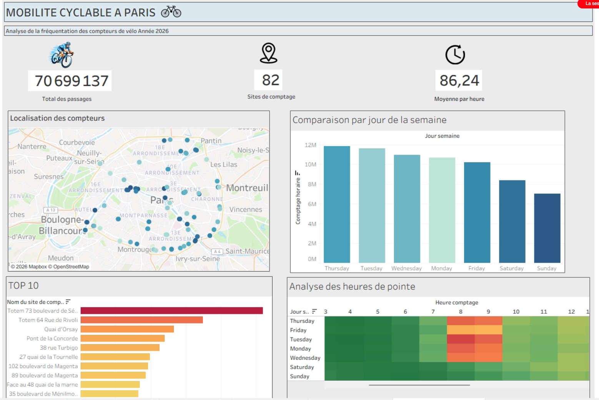
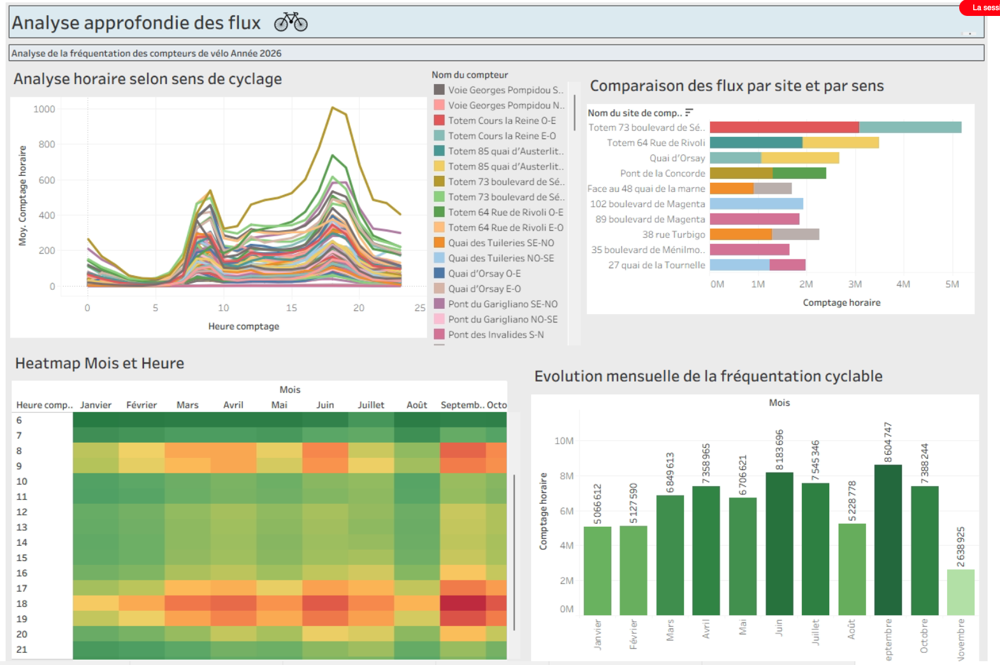

# Mobilité cyclable à Paris — Analyse des comptages vélo (2026)

> Projet de Data Analytics et de SIG consacré à l'analyse de la fréquentation cyclable à Paris à partir de données de comptage horaire. Les données sont stockées dans MySQL, explorées et contrôlées avec SQL, puis valorisées dans deux dashboards Tableau.


## Présentation du projet

Ce projet vise à comprendre comment se répartit la circulation cyclable à Paris dans l'espace et dans le temps. Il s'appuie sur les relevés horaires de compteurs vélo et combine préparation de données, requêtes SQL, analyse exploratoire et visualisation cartographique.

La démarche suit les étapes suivantes :

1. **Explorer les données** et comprendre la structure de la table de comptage.
2. **Contrôler la qualité** : valeurs manquantes, valeurs nulles ou négatives, doublons potentiels et cohérence des dates.
3. **Analyser les volumes** par site, mois, jour de la semaine, heure et sens de circulation.
4. **Cartographier les compteurs** à partir de leurs coordonnées géographiques.
5. **Restituer les résultats** dans deux tableaux de bord Tableau complémentaires.

## Objectifs

- Localiser les sites de comptage et visualiser leur répartition géographique.
- Identifier les sites qui enregistrent les volumes de passages les plus élevés.
- Repérer les jours et les heures de forte fréquentation.
- Étudier les variations mensuelles des volumes observés.
- Comparer les flux selon le sens de circulation lorsque l'information est disponible dans le nom du compteur.
- Préparer de futures analyses spatiales en rapprochant les compteurs des aménagements cyclables.

## Outils et technologies

| Outil | Utilisation |
|---|---|
| **MySQL** | Stockage des données et requêtes d'exploration, de contrôle et d'analyse |
| **SQL** | Agrégations, filtres, jointures éventuelles, sous-requêtes, CTE et fonctions analytiques |
| **Tableau** | Création des feuilles, filtres interactifs, KPI et dashboards |
| **SIG / données géographiques** | Exploitation des coordonnées des compteurs et perspective de croisement avec les aménagements cyclables |

## Données exploitées

La table de travail `comptage` contient notamment les champs suivants :

| Champ | Description / usage |
|---|---|
| `Identifiant du compteur` | Identifiant du compteur, utile pour les analyses à l'échelle du compteur |
| `Nom du compteur` | Libellé du compteur ; peut inclure un suffixe indiquant le sens de circulation |
| `Identifiant du site de comptage` | Identifiant du site regroupant éventuellement plusieurs compteurs |
| `Nom du site de comptage` | Libellé géographique du site |
| `Comptage horaire` | Nombre de passages enregistrés sur le créneau horaire |
| `Date et heure de comptage` | Horodatage du relevé |
| `Date d'installation du site de comptage` | Date d'installation du site |
| `Coordonnées géographiques` | Coordonnées utilisées pour positionner les compteurs sur la carte |
| `Identifiant technique compteur` | Identifiant technique complémentaire |
| `Mois Annee Comptage` | Mois du relevé au format `AAAA-MM` |

**Période représentée dans les captures :** janvier à novembre 2026. Novembre est un mois partiel au moment de la réalisation des captures ; décembre n'est pas représenté. La source officielle du jeu de données, son URL et sa licence doivent être ajoutées ici avant toute diffusion publique du dépôt.

> Les passages comptabilisés ne correspondent pas nécessairement à des personnes uniques : un même cycliste peut être compté plusieurs fois au cours de ses déplacements.

## Tableaux de bord Tableau

### Page 1 — Vue globale de la mobilité cyclable

Cette page présente une lecture synthétique de la fréquentation :

- **KPI — Total des passages** : 70 699 137 passages affichés dans le dashboard.
- **KPI — Sites de comptage** : 82 sites distincts affichés.
- **KPI — Moyenne par relevé horaire** : 86,24 passages en moyenne par enregistrement horaire, selon l'agrégation du dashboard.
- **Carte des compteurs** : localisation géographique des sites.
- **Classement des sites** : les dix sites présentant les volumes cumulés les plus élevés.
- **Comparaison par jour de la semaine** : volumes cumulés du lundi au dimanche.
- **Analyse des heures de pointe** : répartition de l'intensité des passages par jour et par heure.



### Page 2 — Analyse approfondie des flux

Cette page approfondit les comportements temporels et directionnels :

- **Profil horaire des compteurs / directions** : comparaison des profils de fréquentation au fil de la journée.
- **Comparaison des flux par site et par sens** : comparaison des volumes entre les directions représentées.
- **Heatmap mois × heure** : repérage des plages horaires les plus fréquentées selon le mois.
- **Évolution mensuelle** : comparaison des volumes cumulés de janvier à novembre 2026.



## Premiers constats issus des dashboards

Les constats ci-dessous décrivent les graphiques visibles dans les captures. Ils doivent être interprétés en tenant compte de la couverture temporelle et de la disponibilité des compteurs.

- Le KPI du dashboard affiche **70 699 137 passages** et **82 sites de comptage**.
- Le classement fait ressortir notamment le site « Totem 73 boulevard de Sébastopol », suivi de « Totem 64 rue de Rivoli ».
- Le graphique par jour présente les volumes cumulés les plus élevés le jeudi et le mardi, et le plus faible le dimanche. Ces sommes ne sont pas normalisées par le nombre de journées observées.
- Le graphique mensuel affiche les volumes cumulés les plus élevés en **septembre (8 604 747)** et en **juin (8 183 696)**. Novembre affiche **2 638 925**, mais le mois est incomplet dans la période représentée.
- Les heatmaps font apparaître des périodes de forte intensité autour de **8 h–10 h** et de **17 h–19 h**, à confirmer par des indicateurs normalisés et une couverture comparable.

## Méthodologie et précautions d'interprétation

- Un **passage** est un événement mesuré par un compteur ; il ne représente pas un cycliste unique.
- Les **volumes cumulés** dépendent de la durée d'observation et de la disponibilité du compteur. Les comparaisons entre mois, jours ou sites doivent donc être complétées par des moyennes ou des taux calculés sur des périodes comparables.
- Un comptage égal à zéro n'est pas nécessairement une anomalie ; il peut traduire l'absence de passage pendant un créneau.
- Les doublons potentiels doivent être examinés à partir du couple identifiant du compteur / date-heure avant toute suppression.
- Le sens de circulation peut être extrait du suffixe du nom du compteur lorsque le format du libellé est homogène. Cette règle doit être contrôlée sur l'ensemble des valeurs.
- Les fuseaux horaires présents dans les horodatages doivent être traités de façon cohérente. Les comparaisons horaires doivent conserver la référence horaire locale attendue.
- Sur la capture actuelle de la page 2, la légende du graphique de profil horaire affiche **Nom du compteur**. Pour présenter ce graphique comme une comparaison agrégée par sens, vérifier que la couleur utilise bien le champ calculé **Sens de circulation**.

## Organisation recommandée du dépôt

```text
mobilite-cyclable-paris/
├── README.md
├── .gitignore
├── assets/
│   ├── dashboard-1-vue-globale.png
│   └── dashboard-2-analyse-flux.png
├── sql/
│   └── analyses.sql          # Ajouter ici les requêtes SQL commentées
└── data/
    └── README.md             # Informations sur la source et le mode d'accès aux données
```

Les fichiers de données bruts ne sont pas inclus dans ce dépôt. Ajouter le script SQL commenté dans `sql/analyses.sql` et, si la licence le permet, documenter la source des données dans `data/README.md`.

## Reproduire le projet

1. Obtenir le jeu de données d'origine et vérifier ses conditions de réutilisation.
2. Créer une base MySQL et importer les données dans une table de travail nommée `comptage` (ou adapter les requêtes SQL au nom réel de la table).
3. Vérifier les types des colonnes, en particulier le champ `Date et heure de comptage` et les coordonnées géographiques.
4. Exécuter les requêtes SQL d'exploration, de contrôle qualité et d'analyse.
5. Connecter Tableau à la base MySQL et construire les champs calculés nécessaires (date, mois, heure, jour de semaine, latitude, longitude et sens de circulation).
6. Reproduire les deux dashboards et configurer les filtres interactifs.

## Pistes d'amélioration

- Normaliser les volumes par nombre de jours et d'heures effectivement observés.
- Ajouter un indicateur de disponibilité des compteurs.
- Comparer les directions sur des périodes communes et des sites disposant bien de compteurs dans les deux sens.
- Croiser les compteurs avec les couches SIG des pistes et aménagements cyclables (SHP / GeoJSON) afin d'étudier leur proximité et les volumes mesurés.
- Ajouter une analyse spatiale par arrondissement ou secteur, si les données géographiques nécessaires sont disponibles.

## Auteur et licence

- **Auteur :** à compléter.
- **Source des données :** à compléter avec le lien officiel du jeu de données.
- **Licence des données :** à vérifier et à mentionner avant publication.
- **Licence du code et des documents :** à choisir (par exemple MIT pour le code, sous réserve des droits applicables aux données et captures).

---

*Projet personnel de Data Analytics et de SIG consacré à la mobilité cyclable à Paris.*
